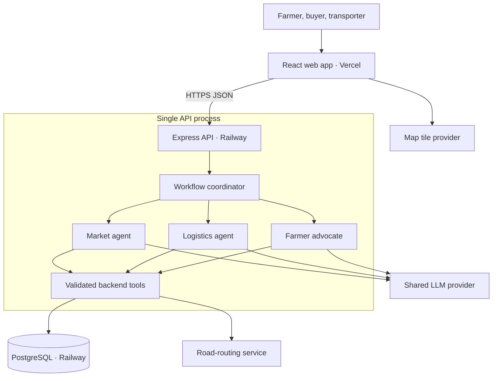

# CropConvoy — Six-Hour Implementation Plan and Architecture

Prepared 24 October 2026. Based on the supplied CropConvoy brief.
Target: four developers, one frontend owner, three AI/backend owners, Vercel frontend and Railway API/database.
This is a scoped hackathon prototype, not a production marketplace.

## 1. Delivery commitment

A farmer describes a harvest, corrects and confirms the extracted fields, pins a pickup location, and publishes. A buyer registers an order. A transporter registers a start, end, departure, free capacity, pricing and detour limits. The system persists a real road route, investigates matching orders and trips, checks route feasibility in backend code, and proposes a sale with a transparent transport quote and net proceeds. The farmer accepts or rejects.

Acceptance means farmer_accepted_pending_confirmations, not a booked vehicle. Buyer/transporter approvals, stock reservation and delivery execution are outside the core six-hour build. No payments, live GPS, group selling, splitting, model training, vector database, microservices or autonomous negotiation.

Assumptions: all four developers know TypeScript; one has GIS/routing familiarity; hosting/GitHub access and an LLM API key with working quota are available at kickoff. Use synthetic demo identities and data. If these assumptions fail, cut scope at the checkpoints below; six hours is an estimate, not a guarantee.

MVP limits:
- One listing → one buyer order → one trip per proposal.
- Sell the entire listing to an order that permits partial fulfillment and has enough remaining demand. No multi-buyer sales.
- Simple, non-looping routes in one tested Sri Lankan corridor; no complex road restrictions or refrigerated loads.
- English text is guaranteed; additional languages need separate tests.
- Typed text is required. Handwritten-note image extraction is optional, only after the full deployed flow passes.
- Static role tabs with demo identities; no claim of verified users or secure role authorization.

## 2. Stack and deployment

| Layer | Choice | Reason |
|---|---|---|
| Frontend | React + Vite + TypeScript; existing CSS/UI components | Small client app; one frontend owner; no SSR needed |
| Maps | React Leaflet + an approved OpenStreetMap-based tile provider | Click to choose locations and display route lines |
| API | Node.js + Express + TypeScript | Same language for all three backend owners |
| Validation | Zod | Runtime checks for API and LLM outputs |
| Database | Railway PostgreSQL; pg parameterized SQL | Persistent routes/listings/orders/plans; one infrastructure provider |
| Geometry | Turf.js in backend | Distance to route and progress along route |
| Road routing | Configurable OSRM-compatible HTTP endpoint | Full route geometry, road distance, duration and legs |
| AI | One existing tool-calling LLM API, three agent roles | Distinct instructions/tools without three hosting services |
| Hosting | Vercel web; Railway API + PostgreSQL | Two application deployments plus database |
| Testing | Existing test runner or Node test; HTTP smoke script | Verify critical decisions, not every UI detail |

Use the LLM provider the team already has working. A Gemini model supporting the required structured output and function calling is one option; validate the exact model ID with a real call in the first 20 minutes. Do not spend the event comparing models or introducing an unfamiliar agent framework.

Use one monorepo with independent web/ and api/ package files and lockfiles. Keep contracts/ as checked-in schemas/examples; both builds must be self-contained within their service root. Avoid a shared workspace package unless already familiar with its deployment configuration.

## 3. Deployment architecture



The browser never accesses PostgreSQL or the LLM API directly. Agent modules call ordinary backend functions in-process, not each other's HTTP endpoints. The orchestrator passes typed objects between modules. Each module can run locally against fixtures.

Map tiles and routing are separate dependencies. Keep required map attribution. Verify the chosen provider's usage policy and Sri Lankan road coverage during kickoff. Do not promise free production hosting or routing capacity. Do not self-host a routing engine within this six-hour build.

## 4. Four-person workload and file ownership

| Person | Owns | AI/backend responsibility | Isolated output | Done when |
|---|---|---|---|---|
| P1 — Frontend | web/** | Calls documented REST APIs; all farmer/buyer/transporter screens and maps; Vercel | UI uses fixtures until endpoints arrive | Deployed UI completes the demo without developer tools |
| P2 — Market + platform | api/src/modules/market/**, api/src/core/**, api/src/server.ts, api/db/**, API package/config files | LLM wrapper, extraction, missing-field handling, crop normalization, market agent, listings/orders CRUD, database bootstrap, Railway | ExtractResult + MarketResult; working health and CRUD endpoints | Extraction requires confirmation; only stored compatible orders are returned |
| P3 — Logistics | api/src/modules/logistics/** | Trip CRUD, full geometry persistence, proximity/order checks, routing adapter, road/time/capacity validation, fare calculator, logistics agent | LogisticsResult with quote/rejection per candidate | Returns a route-backed quote and rejects unsuitable trips |
| P4 — Advocate + workflow | api/src/modules/advocate/**, api/src/modules/workflow/** | Farmer advocate, bounded agent/tool loop coordination, plan assembly, plan persistence, acceptance/rejection, trace and integration checks | PlanResult and decision endpoints | Minimum proceeds enforced, alternatives bounded, accepted state is accurate |

P2 owns the database schema and common SDK wrapper, not everybody's SQL. P3/P4 supply their table requirements in the first 20 minutes and implement repositories inside their own module. P2 provides the database connection.

P4 owns contracts after the kickoff agreement. P2 alone changes server registration, the API lockfile and shared runtime configuration. P1 owns the web lockfile. This prevents the highest-frequency merge conflicts.

Each AI/backend owner delivers an agent prompt, tool definitions, deterministic tool implementations, input/output validation, fixtures, and rejection examples. All three do meaningful AI and backend work.

## 5. Isolation and integration contracts

First 30 minutes:
1. Freeze field names, units, endpoints and error shape.
2. Commit request/response examples and a common happy-path fixture.
3. Export all module interfaces as stubs immediately.
4. Wire the API to the stubs and deploy the skeleton.
5. Work independently by replacing the stub bodies.

Global conventions:
- API locations: { lat, lng }; GeoJSON and OSRM coordinates: [lng, lat].
- All dates cross the API as ISO 8601 UTC with a timezone. Display Asia/Colombo. Send local date/time context with extraction so “tomorrow” is not guessed from server timezone.
- All distances in meters and durations in seconds.
- All money in integer LKR minor units (100 minor units = Rs. 1).
- Core demo quantity is whole kg, positive integer.
- Server-generated IDs; stable crop enum such as tomato, potato, carrot.
- AI never fills missing price, quantity or date with an invented value.
- Errors: { error: { code, message, fields? } }; 422 validation, 404 missing ID, 409 stale/conflicting decision, 503 unavailable dependency.
- A valid search with zero suitable options is a normal result, not a server crash.

Internal TypeScript interfaces:
```ts
type Point = { lat: number; lng: number };

type ExtractResult = {
  draft: {
    crop: string | null;
    quantityKg: number | null;
    locationText: string | null;
    readyAt: string | null;
    minNetMinor: number | null;
  };
  missingFields: string[];
  questions: string[];
};

type MarketResult = {
  listingId: string;
  candidateOrderIds: string[]; // existing validated IDs only, max 3
  reasons: Record<string, string>;
};

type LogisticsResult = {
  options: Array<{
    orderId: string;
    tripId: string;
    quoteId: string;
    extraDistanceM: number;
    deliveryAt: string;
    transportMinor: number;
  }>;
  rejections: Array<{ orderId: string; tripId: string; codes: string[] }>;
};

type ReviewResult = {
  verdict: "recommend" | "try_alternative" | "no_feasible_plan";
  selectedQuoteId: string | null;
  reasonCodes: string[];
  explanation: string;
};
```

Each module exports one registerRoutes(router, dependencies) function plus its core agent/service functions. Dependencies include db, llm, routing and clock interfaces. A fake implementation makes isolated tests possible. P3 can use a fake LLM wrapper until P2 finishes the shared wrapper; P4 can consume stored MarketResult and LogisticsResult fixtures.

## 6. API surface

| Endpoint | Owner | Input / output |
|---|---|---|
| GET /health | P2 | Version/status; deployment health |
| POST /api/harvest/extract | P2 | Text + local time context → ExtractResult; no automatic publishing |
| POST /api/listings | P2 | Confirmed fields + pickup → saved listing |
| GET /api/listings/:id | P2 | Saved listing |
| GET /api/orders | P2 | Registered orders |
| POST /api/orders | P2 | Crop, demand, price, destination, deadline, partial-fill permission |
| GET /api/trips | P3 | Stored journeys |
| POST /api/trips | P3 | Start/end, departure, capacity, fare/detour rules → persisted road route |
| POST /api/plans/generate | P4 | listingId → result, alternatives, rejection reasons and agent trace |
| GET /api/plans/:id | P4 | Persisted proposal, figures, route and current status |
| POST /api/plans/:id/decision | P4 | accept or reject → pending-confirmations or rejected |

The frontend needs no separate HTTP call to every agent. One generation endpoint coordinates them.

Optional note upload: POST /api/harvest/extract-image, owned by P2, only after the typed flow works. Restrict MIME/size, keep image transient, extract declared text only and require correction/confirmation. This does not authenticate a farmer's statements or assess produce quality.

## 7. Persistence model

Use a single initial schema migration written by P2. Foreign keys, positive-value checks, status constraints and timestamps are sufficient for the prototype. JSONB keeps geometry and proposal details simple; no PostGIS setup is required for a small seeded dataset.

| Table | Essential columns |
|---|---|
| listings | id, demoFarmerId, crop, quantityKg, pickupLat/Lng, readyAt, minNetMinor, sellerDeclared=true, status, createdAt |
| orders | id, demoBuyerId, crop, remainingKg, pricePerKgMinor, deliveryLat/Lng, deadlineAt, allowsPartial, status |
| trips | id, demoTransporterId, start/end coordinates, departureAt, availableKg, routeGeoJSON JSONB, routeDistanceM, routeDurationS, routeProvider/profile, corridorM, maxExtraDistanceM, maxExtraTimeS, baseMinor, perKmMinor, handlingMinor, status |
| plans | id, listingId, orderId, tripId, quantityKg, status, quoteSnapshot JSONB, review JSONB, trace JSONB, expiresAt, createdAt |

quoteSnapshot includes gross/transport/net amounts, pricing inputs, base and modified geometry, distances and durations, ETA, evaluated rule outcomes, source IDs and generatedAt. Numeric fields in UI come from this snapshot, not prose from the LLM.

GET plan works after a refresh or API restart. Trace is a short list of observable actions and tool outcomes, not hidden chain-of-thought. Log request IDs and timings; never API keys.

## 8. Agent behavior and bounded workflow

These are three specialized tool-using roles sharing one model. They are not trained models and they are not allowed to change business rules.

Market:
- Extract harvest fields through schema-constrained output.
- Request missing information; farmer reviews exact dates and quantities.
- During planning, call searchOrders with validated listing constraints.
- Return up to three real order IDs and evidence-backed reasons.
- Code filters exact crop, quantity, availability and partial-fill policy.

Logistics:
- Call findCandidateTrips for an order/listing.
- Ask evaluateTrip for a small number of shortlisted trip IDs.
- Explain exclusions using returned reason codes and compare computed quotes.
- Cannot override capacity, routing failures, dates or detour limits.

Advocate:
- Call reviewQuote against the farmer's minimum net proceeds and requirements.
- Prefer the highest feasible net proceeds; the server sorts and verifies.
- Request one alternative if the first is unsuitable.
- Return a brief grounded explanation and unconfirmed conditions.
- Cannot approve on behalf of farmer, buyer or driver.

Runtime:
1. User confirms and publishes listing.
2. Coordinator runs Market and validates returned IDs.
3. Logistics evaluates a bounded candidate set.
4. Code computes gross, transport and net amounts.
5. Advocate reviews and may request one alternative.
6. Coordinator validates the selected quote and persists the proposal.
7. Frontend shows outcome and recorded agent actions.
8. Decision endpoint records farmer acceptance/rejection.

Bound the tool runner: at most 2 model turns per role, 1 alternative attempt, 3 buyer candidates and 6 routed buyer/trip combinations overall. Set a 45-second total generation deadline, individual dependency timeouts and limited concurrency. Stop early when sufficient valid options exist. Return evaluated options and mark searchComplete=false if time is exhausted; never claim a global optimum.

Tool arguments are schema-validated. Tool names come from an allowlist. SQL is parameterized. Record LLM mode as live or deterministic_fallback. If AI fails, typed form entry and deterministic matching can still work, with an honest status label. Do not present fixture reasoning as a live AI result.

## 9. Routing and fare algorithm

Trip registration:
- Route start → end using geometries=geojson and overview=full.
- Store full LineString, road distance, duration, provider/profile and departure.
- Keep base geometry separate from each proposal's modified geometry.
- Use a tested hosted routing service. Cache the chosen demo corridor; never draw a straight line and label it a road route.

Candidate filtering:
1. Exact crop match and enough buyer demand for the whole listing.
2. Trip capacity >= listing quantity.
3. Project pickup and delivery onto the stored LineString using Turf nearestPointOnLine.
4. Require both point-to-route distances <= corridorM (e.g. 3,000 m).
5. Require pickup's progress along route < delivery's progress.
6. Reject ambiguous looped/self-crossing routes for this MVP.
7. Check that departure and farmer readiness are potentially compatible.

Road validation:
- Request start → pickup → delivery → end in that order.
- OSRM can choose a different corridor when waypoints change. For the demo, restrict trips to simple tested routes, preserve necessary original corridor waypoints if used, and show the modified route explicitly as a proposal requiring transporter approval. Do not claim the original path is automatically preserved.
- Validate waypoint snapping: a far-away snapped road point must not silently count as a pickup. Set and test a small configurable snap tolerance, such as 100 m for chosen accessible road pins; reject or request a corrected pin.
- Verify route exists, extra distance/time are within allowed limits, and available capacity is enough.
- Pickup ETA = departure + first-leg duration.
- Require pickup ETA >= readyAt; MVP does not optimize waiting.
- Delivery ETA = departure + first two leg durations + fixed loading time, e.g. 10 minutes.
- Require delivery ETA <= buyer deadline.
- Extra driving distance = max(0, modifiedDistanceM - baseDistanceM).
- Extra driving time = max(0, modifiedDurationS - baseDurationS); add loading/unloading time when validating total extra operational time.
- Distances are road estimates. Ordinary car routing is not proof of heavy-truck suitability, road permissions or live traffic conditions.

Pricing:
transportMinor = baseMinor + round(extraDistanceM / 1000 × perKmMinor) + handlingMinor
grossMinor = quantityKg × pricePerKgMinor
netMinor = grossMinor - transportMinor
eligible = netMinor >= farmer.minNetMinor

This implements the uploaded brief's incremental-detour pricing. It does not charge the full distance from pickup to destination. Confirm this as the team's MVP tariff at kickoff. Even a zero-detour shipment retains the base/handling charge. Show “estimated proceeds before production costs and other unspecified fees.”

## 10. Six-hour schedule

| Time | P1 — frontend | P2 — market/platform | P3 — logistics | P4 — advocate/workflow | Integration gate |
|---|---|---|---|---|---|
| 00:00–00:30 | Scaffold, reusable map/form | API scaffold, DB schema, LLM access | Verify Sri Lankan routing and geometry | Contracts, fixtures, orchestrator stubs | Freeze contracts; choose demo corridor |
| 00:30–01:00 | Deploy shell to Vercel | Deploy API/DB to Railway, health, core CRUD | Trip save and displayable geometry | Fake plan endpoint and plan persistence | Hosted browser reaches API and DB |
| 01:00–02:00 | Farmer input, review, pickup | Live extraction + market tools | Proximity/order checks, routing adapter | Advocate tools, hard-rule checks | Each module runs against fixtures |
| 02:00–03:00 | Buyer/trip forms, plan cards | Search agent + validation cases | Fare/time/detour checks + agent | Coordinator + decision endpoint | Merge modules by 03:00 |
| 03:00–04:00 | Switch mocks to live APIs | Fix shared integration issues | Fix real-route failures | End-to-end run and error states | Full workflow on deployed URLs |
| 04:00–05:00 | Loading/error polish and map route comparison | Missing fields and LLM failure fallback | Wrong direction, capacity, no route tests | Proceeds, stale plan, repeat-decision tests | Feature freeze at 04:30 |
| 05:00–06:00 | Final Vercel build and browser check | Final Railway config and seed check | Validate/cache demo routes | Rehearse, document, recover regressions | Stable demo; final 20 minutes reserved |

No member waits until hour five to combine branches. Short integration checks at hours 1, 2, 3, 4 and 5. Merge the vertical slices as they work. Do not introduce dependencies after feature freeze.

Cut rules:
- At 01:00, if hosting is failing, P2 and P1 prioritize deployment before further features.
- At 02:00, cut handwritten upload, extra languages and styling beyond basic layout.
- At 03:00, if routing is incomplete, reduce to one validated corridor and fewer candidates; keep real geometry, feasibility checks and pricing.
- At 04:00, if plan generation is unstable, use one live buyer/trip pair with deterministic fallback clearly labeled. Preserve live extraction if available.
- At 05:00, only fixes and rehearsal. No new features.
- Never cut route persistence, hard validation, accurate money math or the full hosted happy path to add more AI chat.

## 11. Frontend scope

One app with simple role tabs and a shared map component:
- Farmer: text entry → extracted editable fields → pickup pin → publish → find plan → route/quote/trace → accept/reject.
- Buyer: compact form for crop, quantity, price, delivery pin, deadline and partial-fill permission; existing orders list.
- Transporter: map start/end pins; capacity, departure, base/rate and detour limits; route preview and save.
- Proposal view: buyer, quantity, price, transport, net proceeds, minimum target, original/modified map, constraints and pending confirmations.

Use buttons and form fields instead of a general-purpose chat interface. Keep text extraction separate from publication. Only the farmer confirms the final listing.

## 12. Vercel and Railway deployment checklist

Start within the first hour:
1. Push the agreed skeleton to one GitHub repository.
2. Railway: create PostgreSQL and an API service rooted at api/.
3. Configure the database reference, model secret/model ID, routing URL, CORS origins and demo settings.
4. API build: npm ci && npm run build. Start: npm start, which runs node dist/server.js.
5. Server binds 0.0.0.0 and process.env.PORT. Configure /health as healthcheck; a readiness check should also verify DB connectivity.
6. Apply initial migration in a controlled pre-deploy/release step. Seed synthetic orders/trips once, idempotently; never reset records on server startup.
7. Generate Railway's public API domain.
8. Vercel: root web/, Vite preset, npm run build, output dist.
9. Set VITE_API_BASE_URL to Railway's HTTPS URL, redeploy after changes.
10. Restrict API CORS to the actual Vercel production origin and localhost for development. Add any chosen preview origin explicitly.
11. Use a single-page/tab interface or hash routing to avoid refresh rewrite work. If using browser routes, configure the SPA fallback.
12. Test from a private browser window against deployed URLs, then restart the API and verify persistence.

Railway environment:
DATABASE_URL
LLM_API_KEY
LLM_MODEL
ROUTING_BASE_URL
ROUTING_API_KEY (if provider requires one)
CORS_ORIGINS
DEMO_MODE=true
MAX_PLAN_MS=45000

Vercel public environment:
VITE_API_BASE_URL
VITE_MAP_TILE_URL (only if required by chosen provider)

Never put database or LLM credentials in VITE_ variables. CORS is not authentication. Because this is a demo without real user authorization, use synthetic identities/data, request/body limits, server-side rate limits and bounded candidate searches; keep public deployment controlled. Real user onboarding/auth and actor-bound permissions belong to the production extension.

## 13. Acceptance, consistency and honest limitations

Before accepting, load the plan, check expiry, re-read listing/order/trip and recompute whether data still supports its snapshot. Mark stale plans as 409 and request regeneration. The server must not accept an arbitrary quote object from the browser.

Use a conditional update from proposed to farmer_accepted_pending_confirmations or rejected. Repeating the same decision returns the same state. Conflicting decisions return 409. Do not decrement demand or capacity in this MVP, because there is no completed multi-party booking.

For a later confirmed booking: collect all party approvals, then in one PostgreSQL transaction lock the relevant rows, revalidate stock/demand/capacity, reserve them, and change status to confirmed. This is a future extension, not part of the promised six-hour demo.

## 14. Tests that matter

| Test | Expected result |
|---|---|
| 80 kg × Rs.220; base Rs.350; extra 6 km × Rs.100 | Gross Rs.17,600; fare Rs.950; net Rs.16,650 |
| Minimum Rs.17,000 on that quote | Reject or search alternative; never override minimum |
| Capacity 50 kg for 80 kg listing | Reject |
| Buyer demand smaller than entire listing | Reject; no implicit splitting |
| Buyer is geographically near route but before pickup | Reject |
| Near route but actual road detour exceeds limit | Reject |
| Ready time after pickup ETA or deadline before delivery ETA | Reject |
| Route endpoint snaps far from selected pin | Ask to move pin/reject |
| Routing outage/no route | No fabricated route or quote; return dependency status |
| LLM returns an unknown ID or invalid JSON | Reject/repair once within time budget; deterministic fallback if needed |
| Missing quantity or unclear date | Ask for confirmation; no auto-publish |
| Refresh/restart | Listing, full route and plan still exist |
| Same accept request twice | Same pending-confirmations state; no duplicate action |
| Expired/stale proposal | 409; regenerate |

Demo dataset: 1 farmer, 3 buyer orders and 3 trips on a verified corridor. Include a higher-price buyer with expensive transport, a feasible lower-price buyer with better net proceeds, a wrong-direction/low-capacity rejection and a no-feasible-plan case. Figures are synthetic; actual route distances come from tested routing responses.

Three-minute demo: create/show buyer and trip → type harvest description → confirm extracted fields/pickup → generate plan → show actions/rejections and route → show numeric earnings → accept to pending confirmations.

## 15. Sources and implementation references

The architecture and time estimate are proposed engineering choices. The following official documentation supports the platform/API details:
- Vite on Vercel: https://vercel.com/docs/frameworks/frontend/vite
- Vite client environment variable exposure: https://vite.dev/guide/env-and-mode
- Express deployment on Railway: https://docs.railway.com/guides/express
- Railway port/host binding: https://docs.railway.com/networking/troubleshooting/application-failed-to-respond
- Railway PostgreSQL: https://docs.railway.com/databases/postgresql
- OSRM route API: https://project-osrm.org/docs/v26.4.0/http
- Turf nearestPointOnLine: https://turfjs.org/docs/api/nearestPointOnLine
- Gemini structured output: https://ai.google.dev/gemini-api/docs/structured-output

Pin compatible dependency versions at kickoff and use the corresponding docs. Validate provider access and quotas with live smoke calls; they are not guaranteed by this plan.

